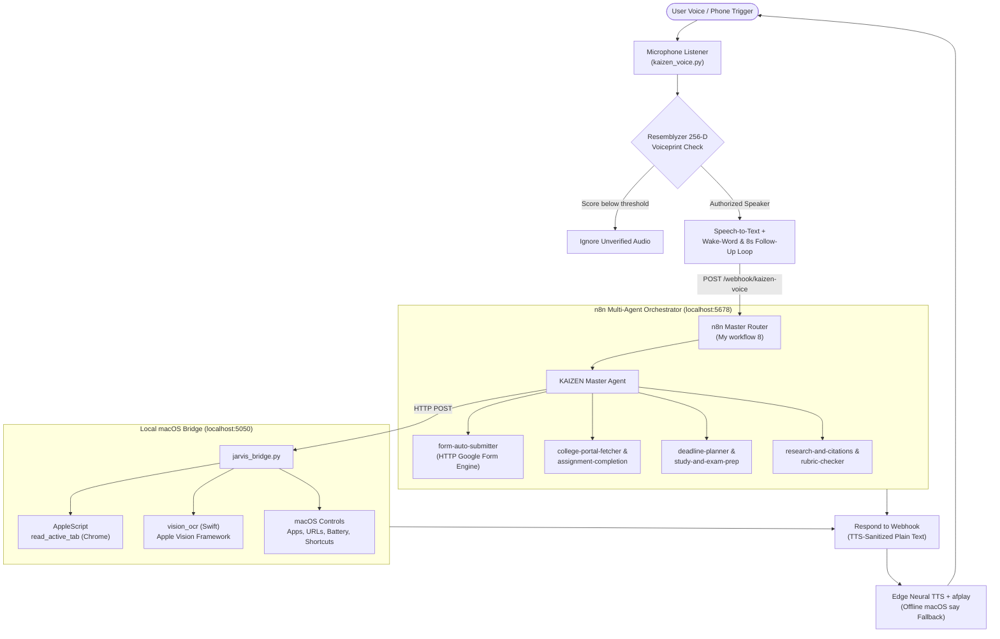

# KAIZEN — Local macOS Voice Biometrics & Multi-Agent Workflow Orchestrator


**KAIZEN** is a JARVIS-inspired, voice-controlled personal AI assistant built natively for macOS. It combines **offline neural speaker verification**, **8-second continuous follow-up listening**, **on-device Apple Vision OCR**, and **neural text-to-speech** with a multi-agent **n8n** orchestration backend for browser automation, form auto-submission, academic research, and macOS system control.

---

## System Architecture



---

## Key Capabilities

* **Biometric Speaker Lock (`resemblyzer`):** Converts incoming audio into a 256-dimensional speaker embedding locally in ~30 ms and compares cosine similarity against an enrolled voiceprint (`my_voiceprint.npy`), ignoring background voices and media playback.
* **Hands-Free Follow-Up Window:** Maintains an 8-second active listening window and shared session context after every response so multi-turn follow-ups work without repeating the *"Kaizen"* wake word.
* **On-Device Screen & Browser Vision:** Reads active Google Chrome tabs via AppleScript (`read_active_tab`) and extracts on-screen text locally via Apple's `VNRecognizeTextRequest` (`vision_ocr.swift`) without sending raw screenshots to external servers.
* **Neural Voice Output:** Synthesizes expressive speech via `edge-tts` (`en-GB-RyanNeural` / `en-IN-PrabhatNeural`) with automatic Markdown/URL stripping and offline fallback to macOS `say`.
* **Autonomous Academic & Form Workflows:** Routes natural-language commands to specialized n8n sub-workflows for HTTP-based Google Form submission, portal scraping, citation formatting, rubric auditing, and Anki flashcard generation.

---

## Repository Structure

```text
jarvis-bridge/
├── kaizen_voice.py      # Wake-word listener, voiceprint gate, 8s follow-up loop & neural TTS
├── enroll_voice.py      # 3-sample enrollment script generating local 256-D speaker embedding
├── jarvis_bridge.py     # Local HTTP bridge (port 5050) for Chrome, screen OCR & macOS controls
├── vision_ocr.swift     # Native Swift CLI wrapping Apple's Vision text-recognition framework
├── workflows/           # Exported n8n master router & specialized agent sub-workflows (.json)
├── requirements.txt     # Python environment dependencies
└── README.md            # Project architecture and setup documentation
```

---

## Quick Setup (macOS)

### 1. Prerequisites
* macOS (Apple Silicon recommended) with **Python 3.12**, **Xcode Command Line Tools** (`swiftc`), and **Google Chrome**
* Local **n8n** instance running on `http://localhost:5678`

### 2. Install Dependencies & Compile Vision OCR
```bash
python3 -m venv .venv
.venv/bin/pip install -r requirements.txt
swiftc vision_ocr.swift -o vision_ocr
```

### 3. Enroll Your Voiceprint
Record three short calibration phrases to generate your local speaker embedding:
```bash
.venv/bin/python enroll_voice.py
```

### 4. Import n8n Workflows
1. Open `http://localhost:5678` in your browser.
2. Import the workflow definitions from `workflows/*.json`.
3. Attach your LLM credentials to the **KAIZEN** agent node and toggle the master webhook workflow **Active**.

### 5. Run as macOS Background Services (`LaunchAgents`)
Start the bridge and voice daemons on login or refresh them anytime via `launchctl`:
```bash
launchctl kickstart -k gui/$(id -u)/com.kaizen.bridge
launchctl kickstart -k gui/$(id -u)/com.kaizen.voice
```

---

## Privacy & Security Design

* **Local-First Biometrics & OCR:** Voice embeddings (`my_voiceprint.npy`) and screen captures are processed locally on-device and never committed to version control.
* **Strict Secret Isolation:** Runtime logs, personal biometric vectors, and environment tokens are excluded via `.gitignore`.
